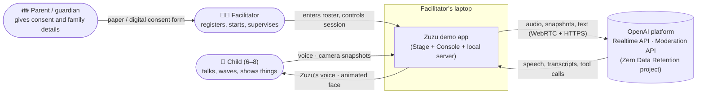
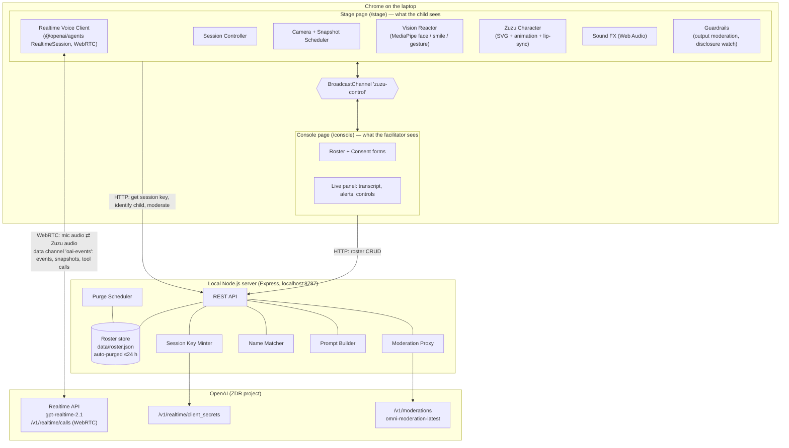
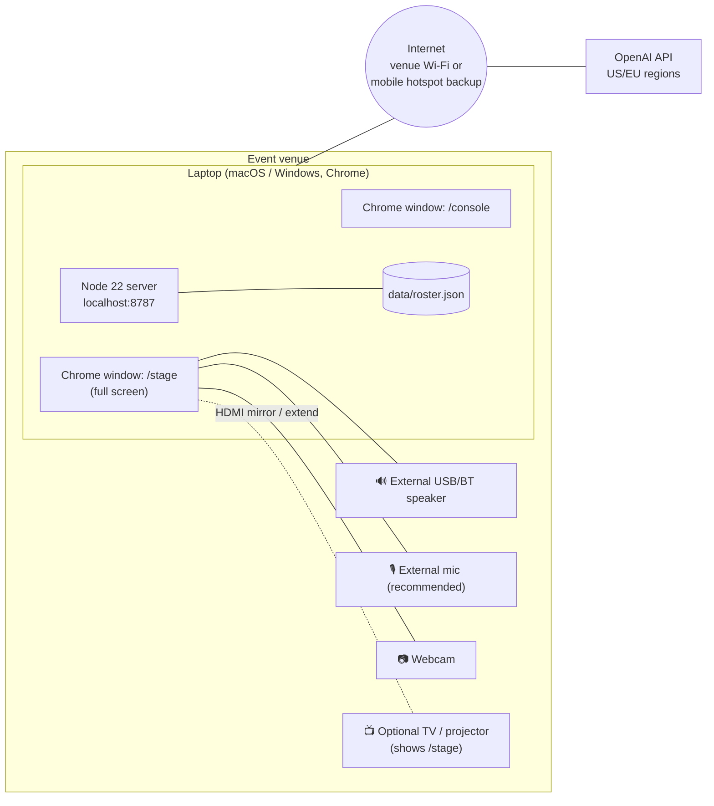
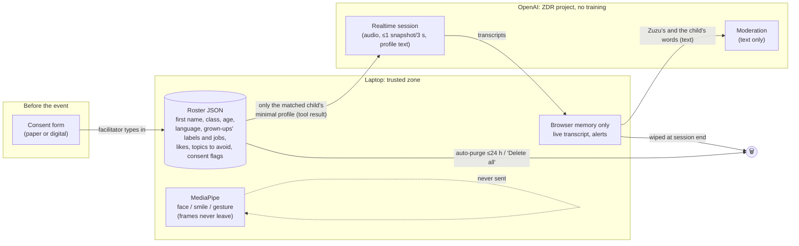
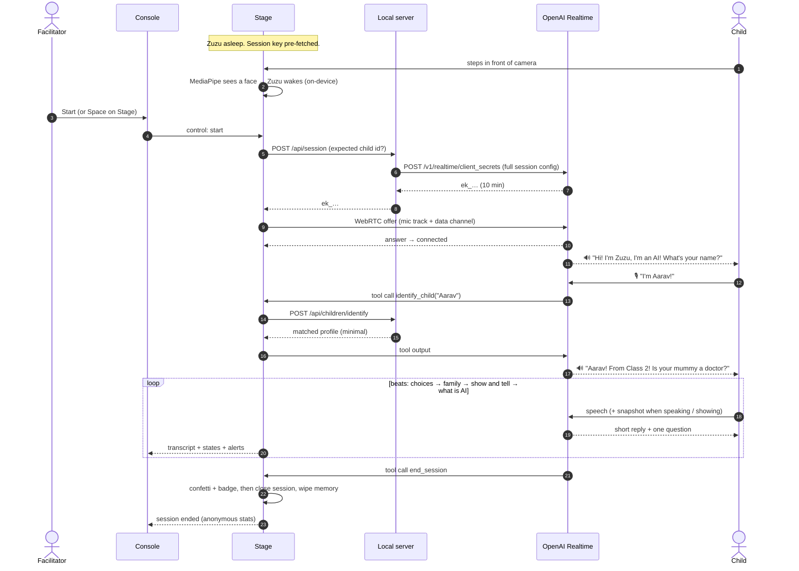
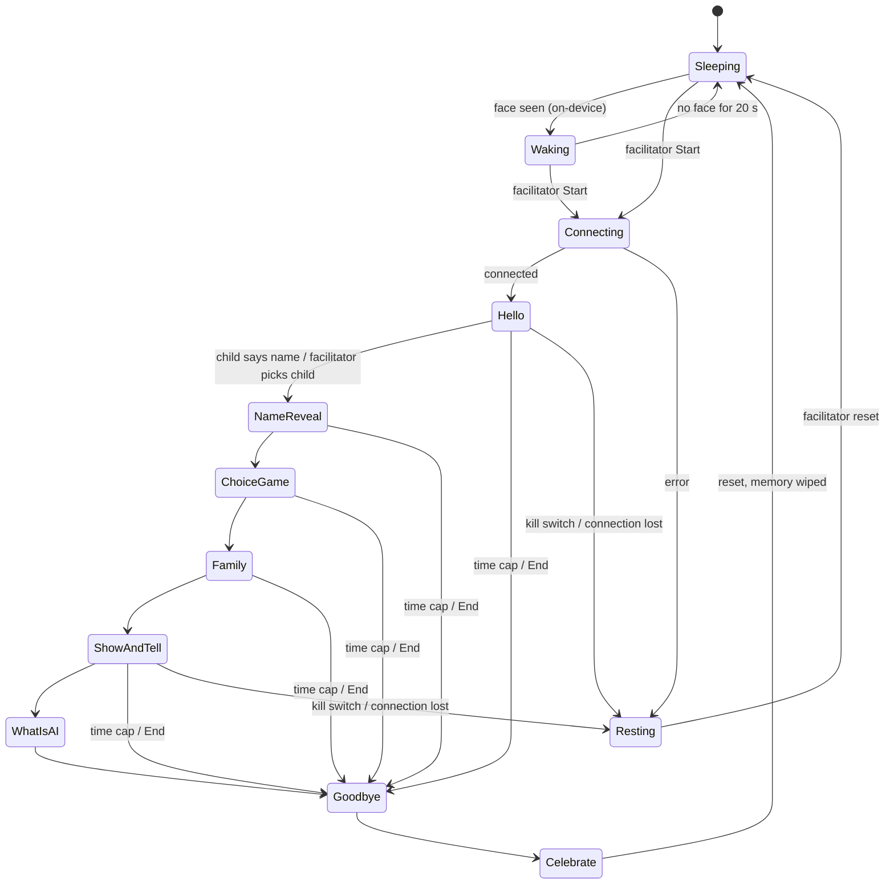
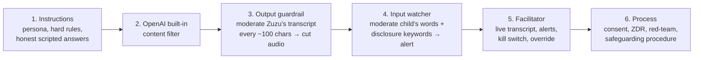

# HLD — "Meet Zuzu" AI buddy demo

| | |
|---|---|
| **Status** | Draft v1.0, 20 Nov 2026 |
| **Reads with** | [PRD](PRD.md) (what and why) · [LLD](LLD.md) (classes, APIs, flows) |
| **Diagrams** | Mermaid. They render on GitHub, and in VS Code with the "Markdown Preview Mermaid Support" extension. |

---

## 1. Architecture at a glance

Zuzu is a **local web app** that runs on the facilitator's laptop. A small Node.js server keeps the OpenAI API key and the day's roster. A Chrome page (the **Stage**) holds the conversation and talks to OpenAI's Realtime API directly over **WebRTC**, using a short-lived key the server mints. A second page (the **Console**) gives the facilitator controls and a live transcript, and talks to the Stage through the browser's `BroadcastChannel`.

The heavy AI work (understanding speech, deciding what to say, speaking, seeing snapshots) is done by **one OpenAI realtime model** (`gpt-realtime-2.1`, OpenAI's current flagship, as its under-18 guidance recommends). The fast, cheap reactions (a face appears, a smile, a wave) run **on the laptop** with MediaPipe, so they are instant and no image leaves the device for them.

### 1.1 System context

### 1.2 Containers

### 1.3 Why this shape

| Decision | Choice | Alternatives considered | Why |
|---|---|---|---|
| AI engine | **OpenAI Realtime API** (speech-to-speech, image input, tools) | (a) A pipeline of speech-to-text → LLM → text-to-speech (OpenAI or Groq); (b) Gemini Live API | One model hears, thinks, sees and speaks, which gives the lowest latency (no hand-offs) and natural interruptions. The pipeline adds 1–2 s and more moving parts. **Gemini's API terms forbid apps likely to be used by under-18s**, so it is ruled out. |
| Model | **`gpt-realtime-2.1`** (switchable to `gpt-realtime-2.1-mini`) | `gpt-realtime-2.1-mini`, `gpt-live-1.1` | OpenAI's under-18 guidance recommends "the most current flagship models" when serving minors; the extra cost is about $0.30 per child. Mini (a third of the cost) is a one-line switch if child-audio tests show it follows the rules equally well. GPT-Live has no image input. |
| Transport | **WebRTC from the browser** with a short-lived key | WebSocket via our server | WebRTC is built for live audio (jitter buffers, echo cancellation) and is OpenAI's recommended browser path. The real API key stays on the server. |
| Client library | **OpenAI Agents SDK** (`@openai/agents/realtime`) | Raw WebRTC + hand-rolled events | OpenAI recommends it. It handles mic, playback, interruptions, tool calls and output guardrails. Raw transport events stay accessible for UI states. |
| Quick reactions | **MediaPipe Tasks Vision in the browser** | Sending frames to the cloud | Instant (<100 ms), free, and private: no images leave the laptop for these. |
| Storage | **A JSON file** with auto-purge | SQLite / a cloud DB | Dozens of children per event, one laptop, data must be deleted within a day. A database would add risk and setup without benefit. |
| Deployment | **Runs locally** (`npm start` on the laptop) | Cloud hosting | Nothing to secure on the internet, no hosted child data, works with any venue Wi-Fi or hotspot. `localhost` counts as a secure context, so camera and mic work without HTTPS. |
| Two pages | **Stage + Console over BroadcastChannel** | One page | The child's screen stays clean (no transcript or parent data), and it still works on one screen via hotkeys and a hidden drawer. |

---

## 2. Deployment

**Run book (summary):** `npm install` once, add `OPENAI_API_KEY` to `.env`, run `npm start`, open `http://localhost:8787/console`, press "Open Stage" (which opens `/stage` in a new window), drag it to the TV and press F11. Full checklist: [LLD §13](LLD.md#13-operations).

---

## 3. Data flow and privacy boundaries

| Data | Where it lives | Leaves the laptop? | Deleted |
|---|---|---|---|
| Roster (first name, class, age, language, grown-ups' labels and jobs, likes, topics to avoid, consent flags) | `data/roster.json` on the laptop | Only the matched child's minimal profile, as tool output inside their session | Auto after 24 h (configurable), or "Delete all" |
| Microphone audio | Streamed live | Yes → OpenAI Realtime (ZDR) | Never stored by us |
| Camera frames for reactions | Browser memory, per frame | **No** | Immediately (each frame discarded) |
| Camera snapshots for "show and tell" | Browser memory → OpenAI | Yes, ≤ 1 per 3 s, 512×384 JPEG | Never stored by us; old ones pruned from the AI session |
| Transcripts | Console and Stage memory | Text to the Moderation API | Wiped at session end |
| Ops log | `data/ops-log.jsonl` | No | Durations, counts, latency, error codes only; **no names or content** |
| OpenAI API key | Server `.env` | Only to OpenAI | — |
| Session key (`ek_…`) | Stage memory | Only to OpenAI | Expires after 10 min |

---

## 4. Key runtime flows (high level)

Detailed message-level sequences are in [LLD §9](LLD.md#9-sequence-diagrams).

### 4.1 One child's session

### 4.2 The experience as a state machine

Beats are **guided, not forced**. Zuzu's instructions describe the beats; the model moves between them according to the conversation and reports each move with the `set_activity` tool, which the Stage uses for visuals. The Stage's timekeeper nudges the model if a beat overruns (§5.3).

---

## 5. Component responsibilities

### 5.1 Stage (React, child-facing)
| Component | Responsibility |
|---|---|
| **Session Controller** | Owns one child's session from start to wipe: fetches the key, wires the voice client, camera, vision and character together, runs the timekeeper, handles control messages and the kill switch. |
| **Realtime Voice Client** | Wraps the Agents SDK `RealtimeSession` (WebRTC). Exposes typed events (child speaking, Zuzu speaking, transcripts, tool calls) and commands (send snapshot, add system note, nudge reply, interrupt, close). |
| **Tools** | Functions Zuzu can call: `identify_child`, `set_activity`, `look_closely`, `ask_grown_up_for_help`, `end_session`, `wait_for_user`. |
| **Camera + Snapshot Scheduler** | One `getUserMedia` video stream shared by MediaPipe, the preview and snapshots. Sends small JPEG snapshots on triggers (child starts speaking, gesture, `look_closely`) at most once per 3 s, never asking for a reply, and prunes old ones. |
| **Vision Reactor** | MediaPipe Face Landmarker (presence + smile) and Gesture Recognizer (wave/open palm, thumbs-up) at ~10–15 fps → debounced reaction events. |
| **Character** | SVG Zuzu: expression layer, eyes and blinking, breathing, mouth driven by the voice's loudness, state glow and rings. |
| **Lip-sync + mic meters** | Web Audio `AnalyserNode`s on Zuzu's audio (mouth) and the child's mic (listening ring). |
| **Repair Coordinator** | Silence ladder timers. Asks the model for a gentle re-prompt; alerts the facilitator after two unanswered nudges. |
| **Guardrails** | Output guardrail (moderates Zuzu's words every ~100 characters and cuts audio if flagged), input watcher (moderation + a disclosure keyword list on the child's words → Console alerts). |
| **Sound FX + Celebration** | Synthesised chimes; confetti and badge. |

### 5.2 Console (React, facilitator-facing)
Roster form and list (with consent), CSV import, "up next", Start / End / Kill / Mute / Camera / Nudge / Skip-to controls, live transcript, alert feed, rehearsal banner, "Delete all data".

### 5.3 Local server (Express)
| Module | Responsibility |
|---|---|
| **Config** | Loads and validates `.env` (API key, model, voice, ZDR confirmed flag, timings, purge window). |
| **Roster Store** | CRUD for children in `data/roster.json` (atomic writes); purge of expired and all records. |
| **Name Matcher** | Normalises and phonetically matches a spoken name against today's roster (Indian transliteration rules + edit distance); returns matched, ambiguous or none. |
| **Prompt Builder** | Builds Zuzu's instructions (persona, speaking rules, beats, safety, honest answers), the tool list, and the minimal child profile text. |
| **Session Key Minter** | Calls `POST /v1/realtime/client_secrets` with the full session config (model, voice, VAD, transcription hints, tools, instructions, tracing off) and a random safety identifier. |
| **Moderation Proxy** | `POST /api/moderate` → `omni-moderation-latest`; returns flagged + categories. Never logs the text. |
| **Purge Scheduler** | Every 10 min deletes roster entries older than the retention window. |
| **Ops Logger** | Appends anonymous session stats to `data/ops-log.jsonl`. |

---

## 6. Cross-cutting concerns

### 6.1 Latency budget (end of child's turn → Zuzu's voice)

| Step | Budget |
|---|---|
| Turn-end detection (semantic VAD, low eagerness; waits longer if the child trails off) | 300–1,500 ms (deliberately patient) |
| Model first audio (mini, reasoning `low`) | 400–800 ms |
| Network + jitter buffer | 100–200 ms |
| **Total p50 target** | **≤ 1.2 s after detection** |
| Thinking pose shown | ≤ 200 ms after turn end (covers the wait) |

Levers if it feels slow: reasoning `minimal`, shorter instructions, VAD eagerness `medium`, the facilitator's "nudge reply" key.

### 6.2 Safety layers (defence in depth)

### 6.3 Security
- The API key lives only in the server's `.env`; the browser receives a 10-minute `ek_` key, minted per session.
- The server listens on `127.0.0.1` only (configurable). No auth is needed for a single-operator local tool; if `HOST` is set to a LAN address, a `CONSOLE_PIN` becomes required.
- No third-party analytics, no CDN calls with child data. MediaPipe model files are fetched from Google's CDN at startup (no child data involved) and can be vendored for offline venues.

### 6.4 Failure handling

| Failure | Child sees | Facilitator sees | Recovery |
|---|---|---|---|
| Key mint fails (no internet, bad key) | Zuzu stays asleep / "yawns" | Error + reason | Fix network; press Start again |
| WebRTC drops mid-session | Zuzu "takes a nap" | "Connection lost" + Reconnect | Reconnect starts a fresh session with the same child (profile re-sent) |
| Mic or camera permission denied | Zuzu asleep | Permission instructions | Grant permission, reload |
| MediaPipe fails to load | No instant reactions (still works) | Warning | Continue; vendored models |
| Moderation API slow or down | Nothing | Warning "moderation degraded" | Session continues with the other layers; facilitator watches transcript |
| Model goes silent > 8 s | Thinking animation, then "Hmm, my computer brain is slow today!" (pre-written) | Latency warning | Nudge or restart |

### 6.5 Cost model (per 5-minute session, estimates)

| Model | Audio-only | + event-driven snapshots | + snapshot every 3 s |
|---|---|---|---|
| `gpt-realtime-2.1-mini` | ~$0.11 | ~$0.13 | ~$0.17 |
| `gpt-realtime-2.1` | ~$0.36 | ~$0.45 | ~$0.67 |

Assumes ~250 tokens per low-detail image (unverified) and realtime prices from OpenAI's model pages (Nov 2026). 100 children ≈ $45–67 on the default `gpt-realtime-2.1`, or $13–17 on mini. The ops log records `response.done` usage so real numbers replace these estimates.

### 6.6 Scale
One laptop runs one session at a time; the server handles a single operator. Several demo stations simply run several laptops, each with its own roster. Nothing needs to scale beyond that for v1.

---

## 7. Technology stack

| Layer | Technology | Version (Nov 2026) |
|---|---|---|
| Runtime | Node.js | 22 LTS |
| Server | Express, `openai` SDK, `zod` | Express 5, openai 7.x, zod 4 |
| Front end | React + Vite + TypeScript | React 19, Vite 7, TS 5.x |
| Realtime | `@openai/agents` (realtime) | 0.22.x |
| On-device vision | `@mediapipe/tasks-vision` | 1.2.3 |
| Animation | SVG + CSS transitions + `requestAnimationFrame` | — |
| Celebration | `canvas-confetti` | 1.9.x |
| Tests | Vitest | 3.x |
| AI models | `gpt-realtime-2.1` (voice `marin`; `gpt-realtime-2.1-mini` optional), `gpt-4o-mini-transcribe` (captions), `omni-moderation-latest` | — |

---

## 8. Requirements traceability (PRD → design)

| PRD | Covered by |
|---|---|
| FR-1–FR-6 Roster and consent | Console roster, Roster Store, Purge Scheduler |
| FR-7–FR-12 Start and identification | Vision Reactor (wake), Session Controller, `identify_child` tool, Name Matcher, Console override |
| FR-13–FR-21 Conversation | Prompt Builder, session config (VAD, voice), Repair Coordinator, timekeeper, `wait_for_user` |
| FR-22–FR-27 Vision | Camera + Snapshot Scheduler, `look_closely`, Vision Reactor, prompt rules |
| FR-28–FR-35 Character and screen | Character, lip-sync, Sound FX, Celebration |
| FR-36–FR-41 Facilitator | Console, BroadcastChannel control bus, hotkeys, rehearsal banner |
| FR-42–FR-46 Privacy | Data flow in §3, memory-only transcript, Ops Logger |
| NFR-1–NFR-11 | §6 |
