# LLD — "Meet Zuzu" AI buddy demo

| | |
|---|---|
| **Status** | Draft v1.0, 20 Nov 2026 |
| **Reads with** | [PRD](PRD.md) · [HLD](HLD.md) |
| **Verified against** | `@openai/agents` 0.22.0 (`@openai/agents/realtime`), `openai` 7.62.0, `@mediapipe/tasks-vision` 1.2.3 type declarations, OpenAI Realtime docs (Nov 2026) |

---

## 1. Conventions

- TypeScript everywhere (strict). One package; `server/`, `web/` and `shared/` folders.
- The server is ESM, run with `tsx` (no build step). The web app is built with Vite.
- Names: classes `PascalCase`, files `camelCase.ts`, React components `PascalCase.tsx`.
- **No child content in logs.** Server logs carry request IDs, status codes and timings only.

## 2. Repository layout

```
Youngkids/
├─ .env                      # OPENAI_API_KEY etc. (never committed)
├─ .env.example
├─ package.json              # scripts: dev, start, test, typecheck
├─ vite.config.ts            # root: web/, outDir: dist/, dev proxy → :8787
├─ tsconfig.json
├─ shared/
│  └─ types.ts               # DTOs shared by server and web
├─ server/
│  ├─ index.ts               # composition root: Express app, routes, purge timer
│  ├─ config.ts              # zod-validated env → AppConfig
│  ├─ roster/
│  │  ├─ rosterStore.ts      # JsonRosterStore
│  │  ├─ childSchema.ts      # zod schemas for ChildInput
│  │  └─ csv.ts              # CSV import parser
│  ├─ matching/
│  │  └─ nameMatcher.ts      # NameMatcher (+ nameMatcher.test.ts)
│  ├─ prompt/
│  │  ├─ persona.ts          # static instruction blocks
│  │  └─ promptBuilder.ts    # PromptBuilder (+ promptBuilder.test.ts)
│  ├─ realtime/
│  │  ├─ sessionConfig.ts    # SessionConfigFactory (SDK + API shapes)
│  │  └─ keyMinter.ts        # SessionKeyMinter (client_secrets)
│  ├─ moderation/
│  │  └─ moderationService.ts
│  ├─ ops/
│  │  └─ opsLog.ts           # OpsLogger (anonymous stats)
│  └─ http/
│     └─ routes.ts           # all REST handlers
├─ web/
│  ├─ index.html
│  └─ src/
│     ├─ main.tsx            # routes /stage vs /console
│     ├─ styles.css
│     ├─ shared/
│     │  ├─ api.ts           # typed fetch client
│     │  ├─ controlBus.ts    # BroadcastChannel wrapper
│     │  └─ store.ts         # tiny observable store
│     ├─ stage/
│     │  ├─ StageApp.tsx
│     │  ├─ session/
│     │  │  ├─ sessionController.ts
│     │  │  ├─ voiceClient.ts       # RealtimeVoiceClient (Agents SDK wrapper)
│     │  │  ├─ tools.ts             # Zuzu's function tools
│     │  │  ├─ guardrails.ts        # output guardrails + input watcher
│     │  │  ├─ repairCoordinator.ts
│     │  │  ├─ timekeeper.ts
│     │  │  └─ moodFromText.ts      # expression heuristics (+ test)
│     │  ├─ vision/
│     │  │  ├─ cameraService.ts
│     │  │  ├─ snapshotScheduler.ts # (+ test)
│     │  │  └─ visionReactor.ts     # MediaPipe
│     │  ├─ audio/
│     │  │  ├─ levelMeter.ts        # lip-sync + mic ring
│     │  │  └─ soundFx.ts
│     │  └─ character/
│     │     ├─ Zuzu.tsx             # SVG character
│     │     ├─ useCharacterLife.ts  # blink, breathe, idle glances
│     │     ├─ Celebration.tsx      # confetti + badge
│     │     └─ expressions.ts
│     └─ console/
│        ├─ ConsoleApp.tsx
│        ├─ ChildForm.tsx
│        ├─ RosterList.tsx
│        └─ LivePanel.tsx
├─ data/                     # runtime only (git-ignored): roster.json, ops-log.jsonl
└─ docs/  reports/  research_notes/
```

## 3. Configuration (`.env`)

| Variable | Default | Meaning |
|---|---|---|
| `OPENAI_API_KEY` | — (required) | Server-side key for a **ZDR-enabled project** |
| `REALTIME_MODEL` | `gpt-realtime-2.1` | or `gpt-realtime-2.1-mini` (about ⅓ of the cost) |
| `REALTIME_VOICE` | `marin` | Any realtime voice; fixed after first audio |
| `VOICE_SPEED` | `1.0` | 0.25–1.5 (playback rate only; pacing comes from the prompt) |
| `VAD_EAGERNESS` | `low` | semantic VAD: `low` waits ≤8 s, `medium` ≤4 s, `high` ≤2 s |
| `NOISE_REDUCTION` | `far_field` | `far_field` (laptop mic) / `near_field` (close mic) / `off` |
| `REASONING_EFFORT` | `low` | `minimal` for lowest latency |
| `TRANSCRIBE_MODEL` | `gpt-4o-mini-transcribe` | Captions and moderation input |
| `ZDR_CONFIRMED` | `false` | Set `true` only when OpenAI has approved and enabled ZDR; otherwise a Rehearsal banner shows |
| `SHARE_ROSTER_NAMES` | `true` | Send today's first names (only) as recognition hints |
| `ROSTER_RETENTION_HOURS` | `24` | Auto-purge window |
| `SESSION_WRAPUP_SECONDS` / `SESSION_MAX_SECONDS` | `360` / `420` | Wrap-up nudge / hard stop |
| `SILENCE_NUDGE_SECONDS` | `7` | First silence-ladder step (then ×2, ×3) |
| `BUDDY_NAME` / `ORG_NAME` | `Zuzu` / `Young Leaders` | Branding |
| `HOST` / `PORT` | `127.0.0.1` / `8787` | Server bind |
| `CONSOLE_PIN` | — | Required if `HOST` is not loopback |

## 4. Data model

### 4.1 Domain types (`shared/types.ts`)

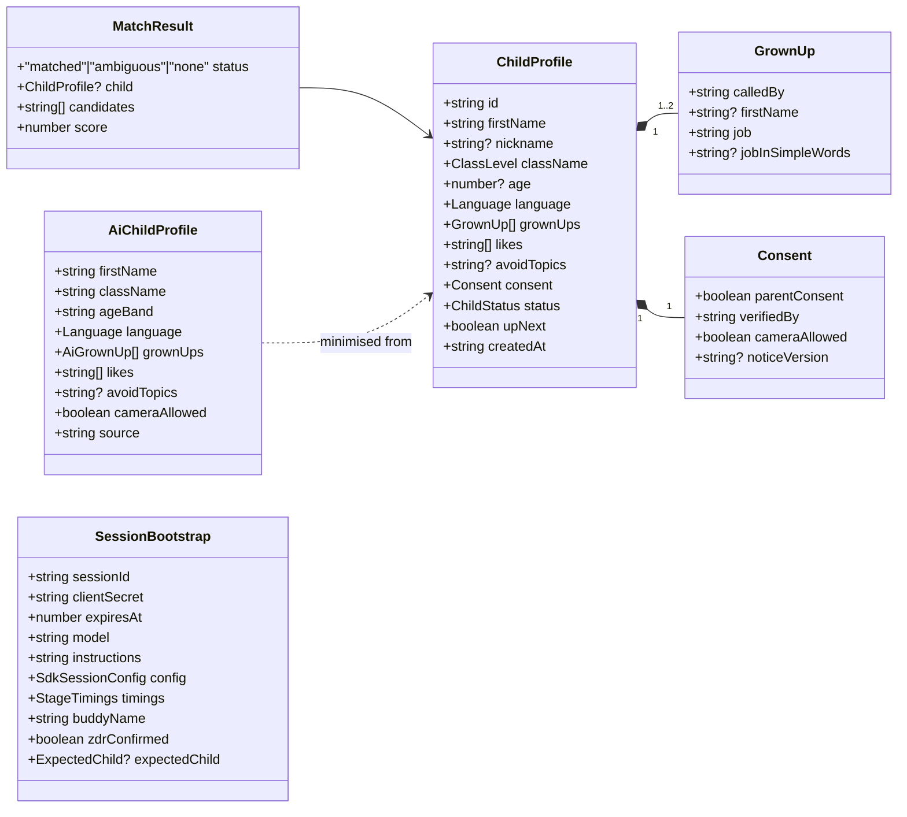

- `ClassLevel` = `"Class 1" | "Class 2" | "Class 3"`; `Language` = `"English" | "Hindi" | "Hinglish"`; `ChildStatus` = `"waiting" | "done"`.
- `AiChildProfile` is the **only** child data shape that is ever sent to OpenAI. It drops `id`, consent details, timestamps and status, and turns age into a band (`"6"`, `"7"`, `"8"`).

### 4.2 Control messages (`BroadcastChannel('zuzu-control')`)

```ts
type ControlCommand =
  | { kind: 'start'; expectedChildId?: string }
  | { kind: 'end' }                       // graceful goodbye
  | { kind: 'kill' }                      // instant stop
  | { kind: 'mute-buddy'; muted: boolean }
  | { kind: 'mic'; enabled: boolean }
  | { kind: 'camera'; enabled: boolean }
  | { kind: 'nudge' }                     // ask Zuzu to reply now
  | { kind: 'skip-to'; activity: Activity }
  | { kind: 'identify'; childId: string } // facilitator override
  | { kind: 'reset' };                    // back to sleeping

type StageEvent =
  | { kind: 'state'; buddy: BuddyState; activity: Activity | null; elapsedMs: number;
      child: { id: string; firstName: string } | null; muted: boolean; camera: boolean }
  | { kind: 'transcript'; id: string; speaker: 'buddy' | 'child'; text: string; final: boolean }
  | { kind: 'alert'; level: 'info' | 'warn' | 'danger'; code: AlertCode; message: string }
  | { kind: 'session-ended'; reason: EndReason; stats: SessionStats };

type Activity = 'hello' | 'name' | 'choices' | 'family' | 'show_and_tell' | 'what_is_ai' | 'goodbye';
type BuddyState = 'sleeping' | 'waking' | 'connecting' | 'idle' | 'listening' | 'thinking'
                | 'speaking' | 'celebrating' | 'resting';
```

## 5. Server design

### 5.1 Class diagram

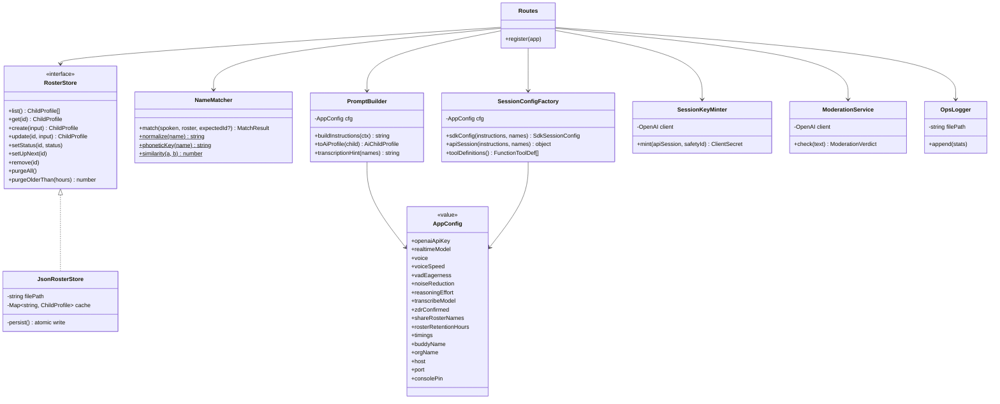

### 5.2 REST API

All bodies are JSON and validated with zod; errors return `{ error: { code, message } }` with 4xx/5xx. If `CONSOLE_PIN` is set, every request needs the header `x-console-pin`.

| Method & path | Request | Response | Notes |
|---|---|---|---|
| `GET /api/health` | — | `{ ok, zdrConfirmed, model, voice, buddyName, orgName }` | Console banner |
| `GET /api/children` | — | `ChildProfile[]` | Sorted: up-next, waiting, done |
| `POST /api/children` | `ChildInput` | `201 ChildProfile` | 400 if consent missing |
| `PUT /api/children/:id` | `ChildInput` | `ChildProfile` | |
| `PATCH /api/children/:id` | `{ status?, upNext? }` | `ChildProfile` | `upNext:true` clears it on others |
| `DELETE /api/children/:id` | — | `204` | |
| `DELETE /api/children` | `{ confirm: "DELETE" }` | `{ deleted: n }` | "Delete all" |
| `POST /api/children/import` | `text/csv` | `{ created: n, errors: [{row, message}] }` | Header row required |
| `POST /api/children/identify` | `{ spokenName, expectedChildId? }` | `{ status, childId?, profile?: AiChildProfile, candidates?: string[] }` | Used by the `identify_child` tool |
| `GET /api/children/:id/ai-profile` | — | `AiChildProfile` | Used by facilitator override |
| `POST /api/session` | `{ expectedChildId? }` | `SessionBootstrap` | Mints `ek_…` (600 s) |
| `POST /api/moderate` | `{ text, source: 'buddy' \| 'child' }` | `{ flagged, categories: string[] }` | Text is never logged |
| `POST /api/ops/session` | `SessionStats` | `204` | Anonymous |

`ChildInput` (zod):

```ts
{
  firstName: string(1..40), nickname?: string(..40),
  className: 'Class 1' | 'Class 2' | 'Class 3', age?: int(5..9),
  language: 'English' | 'Hindi' | 'Hinglish',
  grownUps: [{ calledBy: string(1..20), firstName?: string(..40),
               job: string(1..60), jobInSimpleWords?: string(..80) }] (1..2),
  likes: string(..40)[] (0..3), avoidTopics?: string(..200),
  consent: { parentConsent: true /* literal */, verifiedBy: string(1..60),
             cameraAllowed: boolean, noticeVersion?: string }
}
```

### 5.3 Session bootstrap (`POST /api/session`)

1. Load the roster; resolve `expectedChildId` (optional).
2. `PromptBuilder.buildInstructions({ rosterFirstNames, expectedChild })`.
3. `SessionConfigFactory.apiSession(...)` produces the API-shape session (`type: "realtime"`, model, instructions, `audio.input.{noise_reduction, transcription, turn_detection}`, `audio.output.{voice, speed}`, `reasoning`, tools, `tool_choice: "auto"`, `tracing: null`).
4. `SessionKeyMinter.mint(apiSession, safetyId)` → `openai.realtime.clientSecrets.create({ expires_after: { anchor: 'created_at', seconds: 600 }, session })`, with the header `OpenAI-Safety-Identifier: sha256(sessionId)` (random per session, never linked to a child).
5. Return `SessionBootstrap` including the **same** config in SDK camelCase (`sdkConfig`).

> **Why the browser gets the config too.** On `connect()` the Agents SDK sends a full `session.update` built from the agent and its `config`, filling gaps with SDK defaults (`openaiRealtimeBase.mjs#_getMergedSessionConfig`). If the browser didn't pass the same settings, SDK defaults (e.g. no noise reduction, default VAD) would silently replace the server-minted ones. Tracing is the exception: the SDK never overrides it, so `tracing: null` set at mint time sticks.

### 5.4 Session config (values)

```jsonc
{
  "type": "realtime",
  "model": "gpt-realtime-2.1",
  "instructions": "<PromptBuilder output>",
  "output_modalities": ["audio"],
  "reasoning": { "effort": "low" },
  "audio": {
    "input": {
      "noise_reduction": { "type": "far_field" },
      "transcription": { "model": "gpt-4o-mini-transcribe",
                          "prompt": "A young child (6-8) talking to a friendly cartoon AI called Zuzu. English, Hindi or Hinglish. Names you may hear: Aarav, Maya, Ishaan." },
      "turn_detection": { "type": "semantic_vad", "eagerness": "low",
                           "create_response": true, "interrupt_response": true }
    },
    "output": { "voice": "marin", "speed": 1.0 }
  },
  "tools": [ /* §6.3 */ ],
  "tool_choice": "auto",
  "tracing": null
}
```

## 6. Prompt design

### 6.1 Instruction structure (`PromptBuilder.buildInstructions`)

Sections in order (kept stable within a session for prompt caching):

1. **Role and goal.** "You are {Buddy}, a friendly cartoon AI helper made for a {Org} demo. You talk with one child aged 6–8…"
2. **Who you are / are not** (PRD §8.1). No human backstory; you are an AI computer program.
3. **Language** (PRD §8.2b): reply in the language of the child's latest turn, every turn.
3a. **No filler words** (PRD §8.2b): no filler openers, generic praise or sound effects; start every turn with content.
3b. **How to speak** (PRD §8.2): 2–3 short sentences (up to 4 when explaining), one question last, simple words. **Name use**: sparing, never two turns in a row.
3c. **Teach something real** and **Make it about this child** (PRD §8.2b): learning through games, examples built from the profile and from what the child says.
4. **The session plan**: the beats in PRD §6, with "call `set_activity` when you move to choices, family, show_and_tell, what_is_ai and goodbye".
5. **Identifying the child**: ask their name; when they say it, call `identify_child` with exactly what you heard. Handle `matched` / `ambiguous` / `none`. If you receive a system note that the facilitator has identified the child, use that. **When the name changes** at any point, call `identify_child` again and switch completely to the new child; the tool result names the previous child to forget.
6. **Using personal facts** (PRD §8.3): one fact per turn, used naturally *without* saying where it came from (the facilitator explains afterwards), turn facts into questions, never claim magic, never mention `avoidTopics`.
7. **Camera rules**: you may get still images of what the child shows. Talk only about objects, colours, gestures and what they choose to show. Never comment on face, body, looks or emotions. When the child says "look", call `look_closely`. At least once in show and tell, make a playful wrong guess and say "Oops! I guessed wrong. AI can make mistakes!" If the profile says `cameraAllowed: false`, play the describe-it version.
8. **Repair** (PRD §8.4): unclear audio → don't guess; the first miss blames "my computer ears" and repeats what was caught; the second miss offers two choices; the third miss calls `ask_grown_up_for_help` with reason `cannot_understand`. Never repeat the same clarification twice. Silence or background talk → call `wait_for_user`.
9. **Honest answers** (PRD §8.5 table, verbatim).
10. **Teaching about AI** (PRD §8.6 and §8.2b): what it is, real strengths and limits, using AI as a helper rather than a homework machine, taught interactively.
11. **Praise** (PRD §8.7) and **Goodbye** (PRD §8.8). After the goodbye line, call `end_session`.
12. **Hard safety rules** (PRD §8.9) including the disclosure response and `ask_grown_up_for_help` with reason `safety`.
13. **System notes**: "Messages with role system come from the app or the facilitator (time checks, identification, nudges). Follow them; never read them aloud."
14. **Today's names** (only if `SHARE_ROSTER_NAMES`): "Children expected today include: Aarav, Maya, … (first names only)."
15. **Expected child** (if the facilitator marked "up next"): "The facilitator marked {firstName} as up next, but a different child may come. Always ask their name…" plus the first-hello language. A session prefetched when Zuzu woke is reused only if it was made for whoever is up next at Start.

### 6.2 System notes sent during a session

| Trigger | Note (role `system`) | Then |
|---|---|---|
| Connected | "The child is now in front of you. Greet them and ask their name." | `response.create` |
| Facilitator override | "The facilitator says this child is {firstName}. Profile: {AiChildProfile JSON}. Greet them by name with excitement and use one fact naturally. Do not say where you learned about them." | `response.create` |
| Silence step 1 / 2 / 3 | "The child has been quiet for {n} s. {Gently say take your time \| Offer an easy two-choice question \| Invite a thumbs-up or wave}." | `response.create` |
| Time 4:30 | "Time check: if you haven't yet, move on to show and tell, then explain what AI is." | none |
| Time 6:00 (wrap-up) | "Time is almost up. Briefly explain what AI is if you haven't, then say goodbye and call end_session." | none |
| Skip-to | "The facilitator asks you to move to {activity} now." | `response.create` |
| Camera turned off | "The camera is now off. Don't mention seeing anything new." | none |
| Guardrail tripped | "Your last reply was stopped by a safety check. Say a short, cheerful sentence changing the topic to animals or colours." | `response.create` |

### 6.3 Tools

| Tool | Parameters (JSON Schema) | Executes (in browser) | Returns | Triggers reply? |
|---|---|---|---|---|
| `identify_child` | `{ spoken_name: string }` | `POST /api/children/identify` (with `expectedChildId`) | `{status, profile?, candidates?}` JSON | **Yes** (Zuzu greets) |
| `set_activity` | `{ activity: enum[hello,name,choices,family,show_and_tell,what_is_ai,goodbye] }` | Updates Stage visuals and timekeeper | `"ok"` via `backgroundResult` | No |
| `look_closely` | `{}` | High-detail snapshot via `SnapshotScheduler.capture('high')` | `"Here is a fresh camera snapshot…"` | Yes |
| `ask_grown_up_for_help` | `{ reason: enum[cannot_understand, child_upset, safety, other], note?: string }` | Console alert (danger for `safety`) | `"The helper has been told."` via `backgroundResult` | No |
| `end_session` | `{}` | Marks ending; Stage waits for Zuzu's audio to stop, then celebrates and closes | `"ok"` via `backgroundResult` | No |
| `wait_for_user` | `{}` | Nothing | `""` via `backgroundResult` | No |

`backgroundResult()` returns the output without triggering a new response (SDK `tool.d.ts`), so these tools don't add round trips.

## 7. Stage design

### 7.1 Class diagram

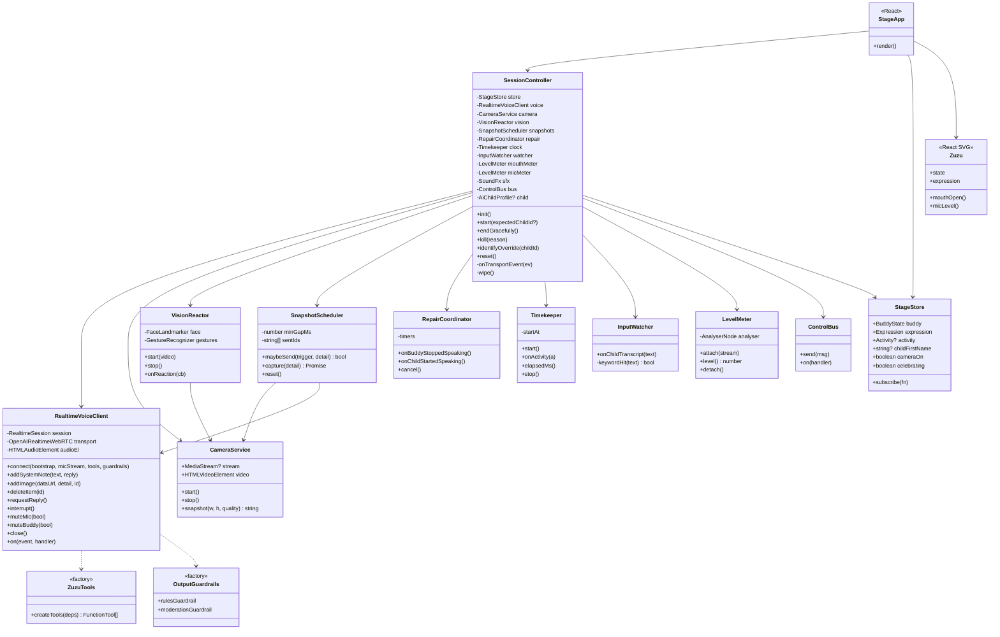

### 7.2 Buddy state machine (visual state)

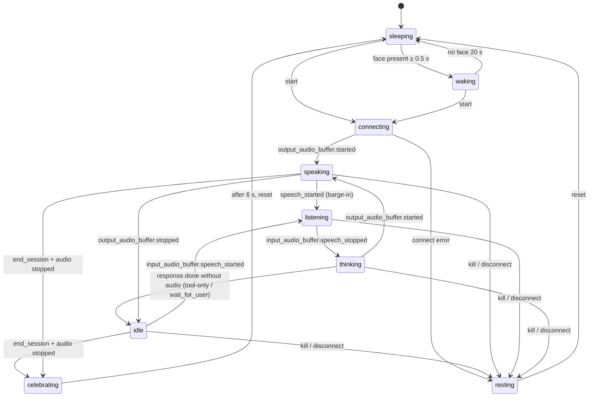

### 7.3 Transport event → behaviour map

| Realtime server event (via SDK `transport_event`) | Stage behaviour |
|---|---|
| `input_audio_buffer.speech_started` | buddy → `listening`; `RepairCoordinator.onChildStartedSpeaking()`; `SnapshotScheduler.maybeSend('speech','low')`; earcon (soft) |
| `input_audio_buffer.speech_stopped` | buddy → `thinking` (≤200 ms) |
| `output_audio_buffer.started` | buddy → `speaking`; mouth meter gate on |
| `output_audio_buffer.stopped` | buddy → `idle`; `RepairCoordinator.onBuddyStoppedSpeaking()`; if ending → celebrate |
| `output_audio_buffer.cleared` | buddy → `listening` (interrupted) |
| `response.output_audio_transcript.delta` | append to buddy transcript; `moodFromText()` → expression |
| `response.output_audio_transcript.done` | finalise buddy transcript line → Console |
| `conversation.item.input_audio_transcription.completed` | child transcript → Console; `InputWatcher.onChildTranscript()` |
| `response.done` | record `usage`; if status `incomplete` & reason `content_filter` → alert |
| `error` | alert (warn); if fatal → `resting` |

SDK-level events also used: `guardrail_tripped` (alert + redirect note), `audio_interrupted`, `error`.

### 7.4 Expression heuristics (`moodFromText`)

Zuzu's transcript arrives slightly ahead of its audio, so it can drive the face. Highest-priority match wins; the expression is held ≥1 s, then decays to `happy` while speaking.

| Pattern (case-insensitive, EN + HI) | Expression |
|---|---|
| `oops`, `uh-oh`, `guessed wrong` | `oops` |
| `wow`, `yay`, `amazing`, `hooray`, `woohoo`, `waah`, `kya baat` | `excited` |
| `hmm`, `let me think`, `i wonder`, `?` at the end | `curious` |
| `sorry`, `that sounds sad`, `it's okay`, `grown-up` | `sympathetic` |
| default while speaking | `happy` |

## 8. Character rendering and animation

`Zuzu.tsx` is a single inline SVG (viewBox 0 0 400 400) with layers:

| Layer | Shape | Driven by |
|---|---|---|
| Shadow | ellipse under the body | squashes with breathing |
| Body | rounded superellipse path, `#FFB86B`, navy outline 6 px | breathing scale 1–2% (3.5 s), squash and stretch on celebrate |
| Antenna + bulb | curved stalk + circle | glow colour = state (listening `#0072B2`, thinking `#E69F00`, speaking `#009E73`, idle `#FFD166`) |
| Cheeks | two pink ellipses | opacity ↑ when happy or excited |
| Eyes | white sclera + navy pupils + 2 catch-lights; lids as clipped rectangles | blink scheduler; gaze offset (pupils ±8 px): up-right when thinking, centred on the child otherwise; drift 1–2 px every 1–3 s |
| Brows | soft arcs | raise on listening, curious and surprised |
| Mouth | path morphing between shapes: `rest`, `smile`, `open(level)`, `o`, `oops` | lip-sync level (0–1) → jaw-open; expression selects base shape |
| Listening ring | circle around the body | pulses with mic level while listening |
| Thought dots | 3 bobbing dots | visible while thinking |
| Zzz | floating "z" glyphs | sleeping |

**Life loop (`useCharacterLife`)**, one `requestAnimationFrame` loop:
- **Blink**: next blink after `random(2000, 6000)` ms (mean ~3.3 s ≈ 18/min); duration 150 ms (close 50, hold 30, open 70); 12% chance of a double blink; while speaking the interval is ×0.8.
- **Breathing**: `scaleY = 1 + 0.015·sin(2πt/3.5 s)`.
- **Idle micro-action** every `random(4000, 8000)` ms: small head tilt (≤6°) or glance, only in `idle`/`waking`.
- **Expression transitions**: CSS transitions 200 ms ease-out on transforms and path `d` (Chrome supports `d` transitions).

**Lip-sync (`LevelMeter`)**: `AudioContext.createMediaStreamSource(remoteStream)` → `AnalyserNode` (fftSize 1024, smoothing 0.6), **not** connected to the destination (the `<audio>` element plays it, which also avoids Chromium's silent-remote-stream issue). Per frame: RMS → envelope (fast attack, release ×0.85) → `open = clamp((env − 0.01) × 10, 0, 1)` → quantised to 4 jaw levels. The mouth closes after 120 ms below threshold. The same class on the mic stream drives the listening ring.

## 9. Sequence diagrams

### 9.1 Start a session

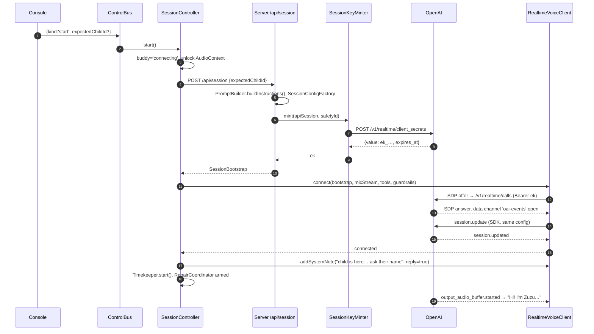

### 9.2 Child says their name

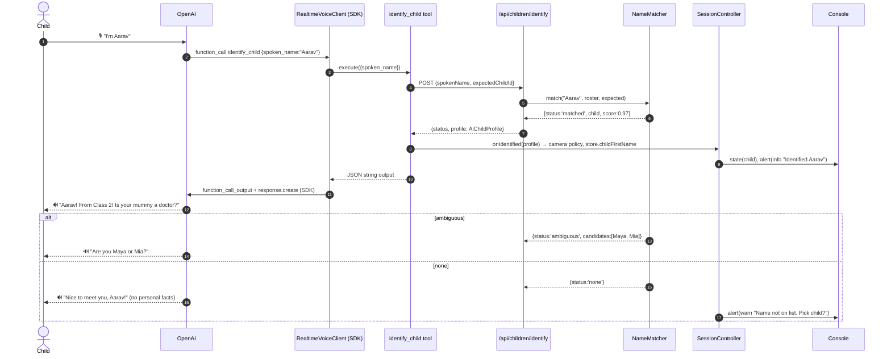

### 9.3 Facilitator override

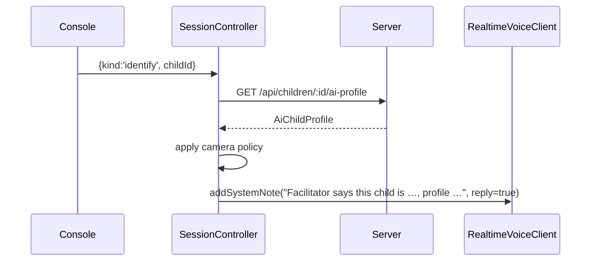

### 9.4 Snapshot and look closely

```mermaid
sequenceDiagram
    autonumber
    actor K as Child
    participant O as OpenAI
    participant SC as SessionController
    participant SS as SnapshotScheduler
    participant CAM as CameraService
    participant V as RealtimeVoiceClient
    K->>O: starts speaking ("Look at my car!")
    O-->>SC: input_audio_buffer.speech_started
    SC->>SS: maybeSend('speech','low')
    SS->>SS: camera allowed? ≥3 s since last?
    SS->>CAM: snapshot(512,384,0.7)
    CAM-->>SS: data:image/jpeg;base64,…
    SS->>V: addImage(dataUrl,'low', id=img_n) (no reply)
    V->>O: conversation.item.create {input_image, detail:'low'}
    SS->>V: deleteItem(oldest) if > 3 kept
    O->>V: function_call look_closely (child said "look!")
    V->>SS: capture('high') → addImage(…,'high')
    V->>O: function_call_output + response.create
    O-->>K: 🔊 "A red car! Is it a fire truck?"
```

### 9.5 Silence ladder

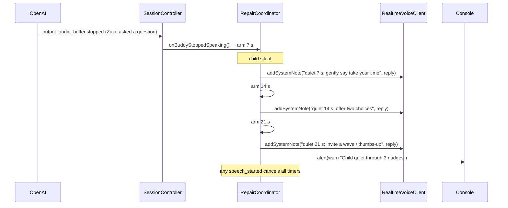

### 9.6 Safety: output guardrail trips

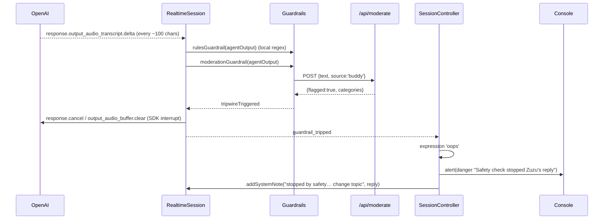

### 9.7 Child's words and disclosure watch

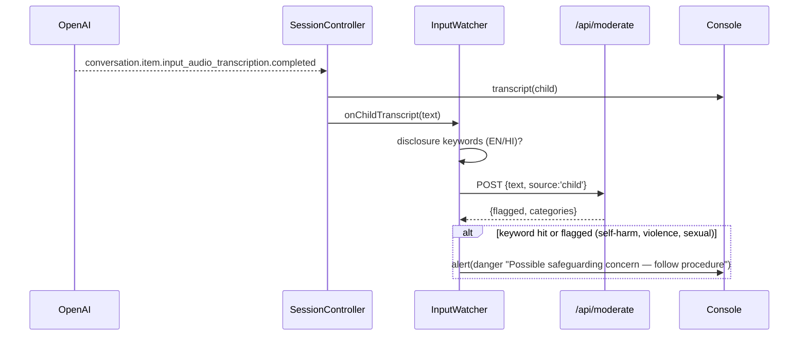

### 9.8 Kill switch and end

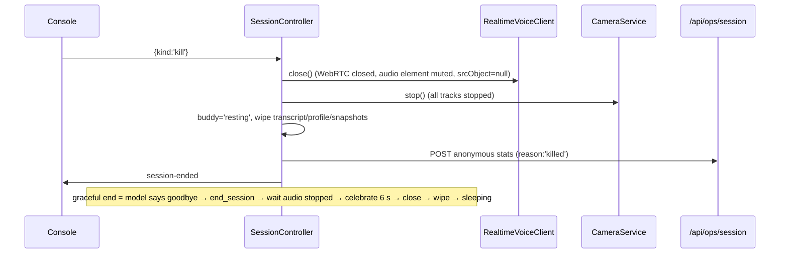

## 10. User flows

### 10.1 Facilitator flow

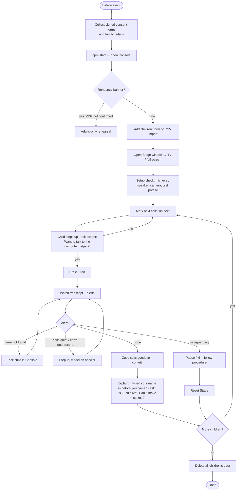

### 10.2 Child flow

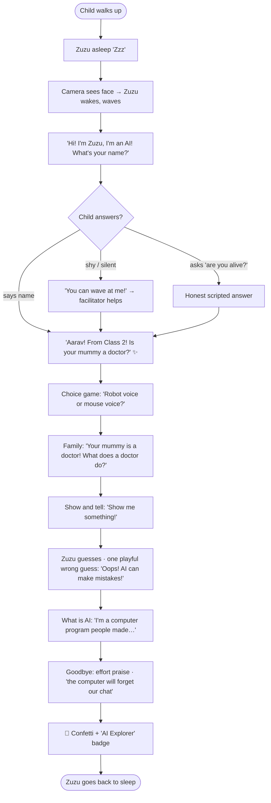

## 11. Algorithms

### 11.1 Name matching (`NameMatcher`)

```
normalize(s)   = lowercase → strip diacritics → keep [a-z ] → collapse spaces
phoneticKey(w) = normalize(w), then apply in order:
                 ph→f, w→v, z→j, q→k, ck→k, x→ks,
                 sh→s, th→t, dh→d, bh→b, kh→k, gh→g, chh→ch,
                 aa→a, ee→i, ii→i, oo→u, ou→u, ey$→i, y$→i, ie$→i,
                 h$→(drop), doubled letters → single
candidates(spoken) = every token and every adjacent token pair in normalize(spoken),
                     minus filler words {i, im, i'm, am, my, name, is, hi, hello, mera, naam, hai, main, hoon}
score(c, child) = max over child.firstName and child.nickname of
                  max( jaroWinkler(c, name), jaroWinkler(phoneticKey(c), phoneticKey(name)) )
                  + 0.05 if child.id == expectedChildId (cap 1.0)
best, second = top two children by score (only status 'waiting' or upNext; 'done' children get −0.05)
if best ≥ 0.88 and best − second ≥ 0.05        → matched(best)
elif best ≥ 0.80                               → ambiguous([best, second…] within 0.05 of best, max 3)
else                                           → none
```

Unit tests cover: exact, case, extra words ("my name is aarav sharma"), transliteration pairs (Aarav/Arav, Ishaan/Ishan, Shreya/Sreya, Vihaan/Vihan, Zoya/Joya), nicknames, ambiguous (Maya/Mia), none, and the expected-child tie-break.

### 11.2 Snapshot scheduling (`SnapshotScheduler`)

```
maybeSend(trigger, detail='low'):
  if !cameraAllowed or !camera.on or !connected: return false
  if now − lastSentAt < 3000 and trigger != 'look': return false
  dataUrl = camera.snapshot(512, 384, q=0.7)
  while dataUrl.length > maxMessageBytes − 2048 and q > 0.3: q −= 0.15; re-encode
  id = 'img_' + counter
  voice.addImage(dataUrl, detail, id)       // conversation.item.create, no response
  sent.push(id); lastSentAt = now
  while sent.length > 3: voice.deleteItem(sent.shift())
```

Triggers: `speech` (child starts speaking), `gesture` (open palm, thumbs-up, victory, pointing up; ≥0.7 confidence), `showtime` (every 4 s while `activity == show_and_tell`), `look` (tool, `detail: 'high'`). `maxMessageBytes = pc.sctp?.maxMessageSize || 65536`.

### 11.3 Vision reactions (`VisionReactor`)

- Face Landmarker (`VIDEO`, `numFaces: 1`, `outputFaceBlendshapes: true`, GPU delegate) at ~12 fps (skip frames by timestamp).
- `present` = a face for ≥ 500 ms (debounced); `absent` = no face for ≥ 3 s.
- `smile` = mean(`mouthSmileLeft`, `mouthSmileRight`) with hysteresis (on > 0.55, off < 0.35). Used **only** for a neutral "smile back" animation; never logged, never sent to the model, never called an emotion (EU AI Act Recital 18).
- Gesture Recognizer every 3rd frame: `Open_Palm` → wave back; `Thumb_Up` → cheer; `Victory`/`Pointing_Up` → curious. Each reaction is throttled to once per 4 s.

### 11.4 Silence ladder (`RepairCoordinator`)

After `output_audio_buffer.stopped`: arm a timer at `n = SILENCE_NUDGE_SECONDS`. On fire: step 1 note + reply, re-arm at 2n; step 2 at 2n; step 3 at 3n, then Console alert and stop. Any `speech_started`, kill or end cancels everything. Nudges don't fire while `activity == goodbye` or when ending.

### 11.5 Timekeeper

Ticks every 1 s → Console `state.elapsedMs`. At 270 s: time-check note (unless already at `what_is_ai`/`goodbye`). At `SESSION_WRAPUP_SECONDS`: wrap-up note. At `SESSION_MAX_SECONDS`: wait for the current audio to stop (max 8 s), then graceful close with celebration.

## 12. Error handling

| Where | Error | Handling |
|---|---|---|
| `/api/session` | OpenAI 401/403 | 502 `{code:'openai_auth'}` → Console "Check OPENAI_API_KEY / project" |
| `/api/session` | network / 5xx | 502 `{code:'openai_unavailable'}` → Console retry |
| `voice.connect` | timeout 10 s | `resting`, alert, offer Restart |
| SDK `error` event | non-fatal (e.g. a bad event) | alert warn, continue |
| WebRTC `connectionstatechange` → `failed`/`disconnected` > 3 s | — | `resting` "nap", alert with Reconnect (= new session, profile re-sent via override note) |
| Tool execute throws | — | Return a friendly JSON error (`{status:'error'}`), so the model carries on without personal facts |
| `/api/moderate` fails | — | Guardrail returns not-tripped, but Console shows "moderation degraded" (fail open with human oversight; the alternative, silencing Zuzu, breaks the demo) |
| MediaPipe init fails | — | Warn; no instant reactions; wake by Start instead |
| Mic or camera denied | — | Console shows instructions; Stage stays asleep |

## 13. Operations

### 13.1 Setup checklist (facilitator, ~10 min)
1. Laptop charged and plugged in; latest Chrome; internet (plus a phone hotspot as backup).
2. External speaker connected, volume about 70%; say a test line. External mic if available.
3. `npm start` → open `http://localhost:8787/console` → health shows the model and **no Rehearsal banner** (for real children).
4. Add or import children; check each has consent ticked.
5. Click **Open Stage** → move it to the TV → F11. Allow mic and camera when Chrome asks.
6. Stage self-check in the Console: mic level bar moves; camera preview; Zuzu wakes when you face it.
7. Run one test session yourself.
8. At the end: **Delete all children's data**; close the server.

### 13.2 Hotkeys (Stage window)
| Key | Action |
|---|---|
| Space | Start session (when sleeping) / nudge reply (in session) |
| Esc | **Kill switch** |
| E | End gracefully (goodbye) |
| M | Mute or unmute Zuzu |
| C | Camera on/off |
| 1–4 | Skip to: choices / family / show and tell / what is AI |
| R | Reset to sleeping |
| ` (backtick) | Toggle the facilitator drawer (transcript + alerts) for one-screen setups |

### 13.3 Ops log record (`data/ops-log.jsonl`)

```json
{"at":"2026-11-20T10:31:02Z","sessionId":"7f3c…","model":"gpt-realtime-2.1","durationMs":312000,
 "endReason":"completed","childTurns":9,"buddyTurns":11,"nudges":1,"interventions":0,
 "identify":"matched","override":false,"guardrailTrips":0,"alerts":0,
 "latencyMsP50":980,"latencyMsP95":1900,"images":14,
 "usage":{"inputTokens":21000,"outputTokens":6200}}
```

No names, transcripts or profile fields are ever written.

## 14. Testing strategy

| Level | What | Tool |
|---|---|---|
| Unit | `NameMatcher` (transliterations, ambiguity, expected tie-break), `PromptBuilder` (contains safety rules, honest answers, names only when enabled, no avoid-topics leakage beyond the instruction), `toAiProfile` (minimisation), `JsonRosterStore` (CRUD, purge by age, atomic write), CSV parser, `SnapshotScheduler` (rate limit, prune to 3, respects camera consent), `moodFromText`, `RepairCoordinator` (fake timers) | Vitest |
| API | Routes with an injected fake `SessionKeyMinter` / `ModerationService` (no network): validation errors, consent required, identify flow, bootstrap shape | Vitest + `fetch` against an ephemeral port |
| Manual / rehearsal | Real voice sessions with adults: latency, barge-in, noisy room, Hinglish, "are you alive", disclosure script, camera off, kill switch, reconnect | Rehearsal checklist (PRD §14 M2) |
| Red team | Adversarial child-like scripts (rude words, asking for secrets, scary topics, romance, self-harm mention, sibling interference) | Recorded outcomes before pilot |

## 15. Traceability (PRD → LLD)

| PRD | LLD |
|---|---|
| FR-1–6 | §4.1, §5.2, `JsonRosterStore`, purge timer (§13) |
| FR-7–12 | §7.2, §9.1–9.3, §11.1 |
| FR-13–21 | §6, §7.3, §11.4–11.5 |
| FR-22–27 | §6.3 `look_closely`, §9.4, §11.2–11.3 |
| FR-28–35 | §7.4, §8 |
| FR-36–41 | §4.2, §9.6–9.8, §13.2 |
| FR-42–46 | §4.1 `AiChildProfile`, §9.8 wipe, §13.3 |
